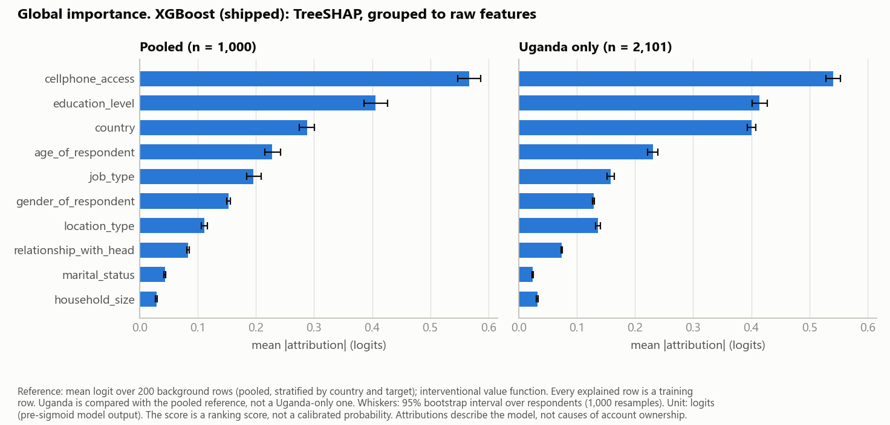
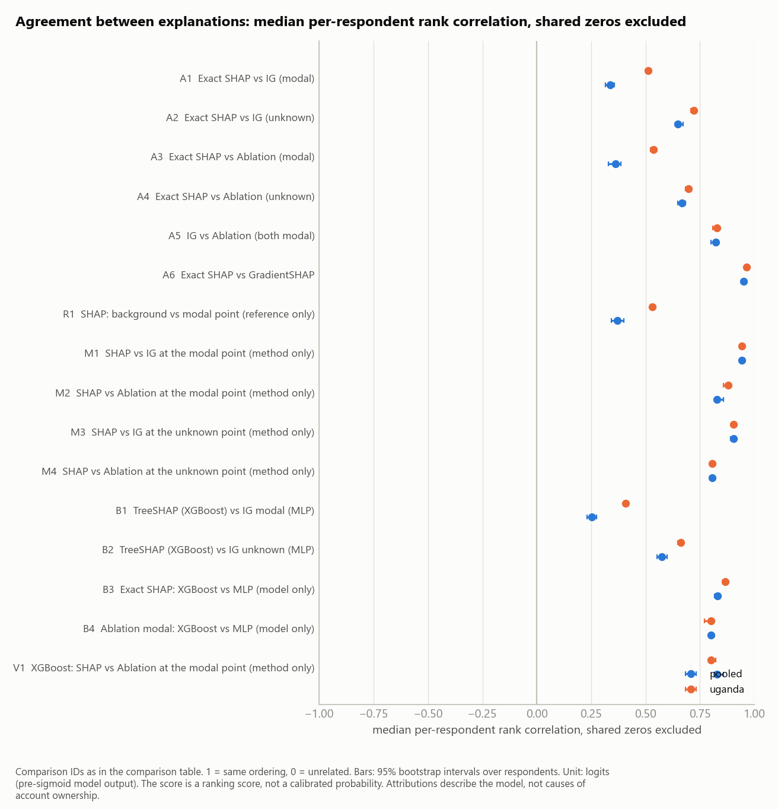
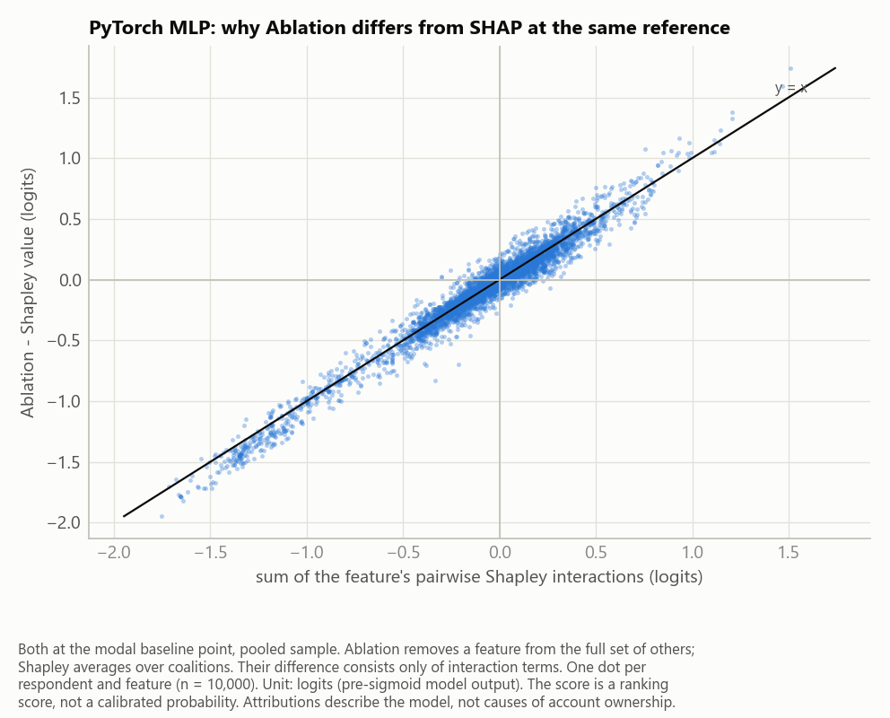
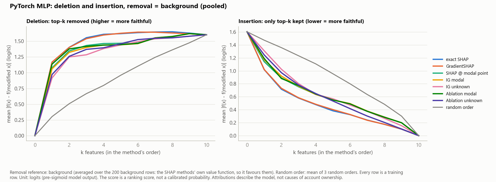

# Explaining account-ownership predictions: SHAP vs Captum

*Financial Inclusion in Africa — Week 3 explainability report. Every number below comes from an artifact in `reports/xai/`, regenerated by `scripts/run_xai_analysis.py`; the reasoning behind each choice is in `reports/xai_decisions_log.md`.*

## 1. Why explain these models

The pipeline predicts whether a survey respondent in Kenya, Rwanda, Tanzania or Uganda has a bank account. A model like this could be used to decide whom an inclusion programme targets, and a decision about a person's access to finance needs to be accountable: someone should be able to say which of that person's answers drove the score, and whether the explanation can be trusted. This report applies two families of explanation methods — SHAP and Captum — to the two candidate models, shows what each model relies on, and tests where the explanations agree, where they diverge, and why.

Three cautions apply to everything that follows. Attributions describe what a **model learned to rely on**, not what causes financial inclusion. The model's output is a **ranking score, not a calibrated probability** (both models were trained with class weighting), so all attributions are in **logits**, where they add up. And **Uganda**, the segment of most interest, is the smallest (2,101 of 23,524 training rows; 181 account holders).

## 2. Setup

**Models.** The shipped XGBoost model (`models/production/`, 40 one-hot inputs) and the PyTorch MLP from the ablation study (8 category embeddings + 3 numeric inputs), which had never been saved and was retrained with its tuned settings. Before anything was explained, both had to reproduce their reported held-out performance on the same 5 cross-validation folds (`model_verification.json`): the MLP reproduced PR-AUC 0.5837 exactly, fold for fold; XGBoost with its shipped settings scored 0.5876 against 0.5901 reported (within the ±0.02 gate; mildly optimistic, as its settings were tuned on all the data). Uganda-only PR-AUC is 0.544 (XGBoost) and 0.542 (MLP).

**One unit of comparison.** The two models encode a respondent differently, so every attribution is summed back to the **10 raw survey fields** of the API contract. This is valid because all methods used are additive decompositions.

**Rows.** A fixed reference ("background") set of 200 training rows, sampled proportionally by country and outcome, and 3,012 explained rows: 1,000 stratified rows for pooled results plus all 2,101 Uganda rows (`sample_sets.json`). Both final models were trained on every labelled row, so all explained rows are training rows; no held-out labels exist.

## 3. Methods

Every explanation compares a respondent with a **reference** and defines what "removing" a feature means (the **value function**). The table states both for each method.

| Method | Library | Models | Reference | Value function |
| --- | --- | --- | --- | --- |
| TreeSHAP | shap | XGBoost | 200 background rows | interventional; players are the 40 encoded columns, summed |
| Exact SHAP (KernelSHAP, all 1,024 coalitions) | shap + own oracle | both | 200 background rows | interventional, on the 10 raw fields |
| GradientSHAP | shap | MLP | 200 background rows | expected gradients in embedding space (sampled) |
| Integrated Gradients | Captum (LayerIntegratedGradients) | MLP | one baseline point | straight path between embeddings |
| Feature Ablation | Captum | both | one baseline point | one field reset at a time, others kept |
| LayerConductance, Gradient×Activation | Captum | MLP | baseline point / none | flow through hidden units |

*Interventional*: a removed field takes a reference row's value independently of the other fields. The two baseline points are **modal** (every answer at its most common value: a rural Rwandan woman, head of household, married, with a phone, primary education, self-employed) and **unknown** (every category set to one never seen in training). Neither is a typical respondent: the MLP scores the unknown point at +0.66 logits, above the average respondent's −1.16 (`captum_summary.json`).

**Ground truth.** With only 10 fields, the exact Shapley value can be computed by brute force over all 1,024 coalitions. This oracle is the yardstick for every SHAP method (`shap_summary.json`):

- KernelSHAP with all coalitions matches it to within 2.4×10⁻¹⁵ (XGBoost).
- KernelSHAP with sampled coalitions converges to it as samples increase.
- Grouped TreeSHAP is close but not identical: a mean gap of 0.004 logits (2.1% of the typical attribution), with the same top field on all 50 test rows. Its 40 encoded columns play a different game from the 10 raw fields, and the two agree exactly only when trees cannot interact, which a unit test confirms.
- All SHAP methods except GradientSHAP add up to the model's logit within 2.2×10⁻⁶. GradientSHAP is a sampled estimate and misses by up to 0.66 logits.

## 4. Results

### 4.1 What the models rely on

*Figure 1 — Phone access, education and country carry most of XGBoost's predictions, pooled and in Uganda (TreeSHAP, mean |attribution| with 95% bootstrap intervals).*

Shares of importance on the pooled sample: phone access 0.27, education 0.19, country 0.14, age 0.11, job type 0.09 for XGBoost; phone access 0.22, education 0.17, country 0.17, job type 0.13, age 0.10 for the MLP (`shap_summary.json`). In Uganda, country rises to 0.19 (XGBoost) and 0.22 (MLP, where it ranks first). Part of that rise is built in: every Ugandan has the same country, which the pooled reference mostly does not. Across all ten attribution sets, phone access is in the top three under every method pooled, and country, phone access and education are the top three under all ten in Uganda (`internals_summary.json`).

What separates the respondents each model confidently says "yes" to from those it confidently says "no" to is mostly **education**. Its mean attribution differs by 1.07 logits between true positives and true negatives for XGBoost (95% CI 0.97–1.16) and by 1.51 for the MLP. Phone access has the largest *average* effect, largely by pulling down respondents without a phone.

**Local explanation.** For a typical Ugandan respondent (the one whose score is closest to Uganda's median; score 0.17, predicted no account):

- no formal education lowers her logit by 0.45;
- living in an urban area raises it by 0.39;
- being in Uganda lowers it by 0.27.

**Internals.** Neither model has an attention mechanism, so no attention map exists and none is shown. Two substitutes:

- **Embeddings:** 2-D projections of the MLP's learned category embeddings, coloured by each answer's average effect, show that position in the embedding space does not line up with effect ("no formal education" and "tertiary" sit on the same side), and no single dimension carries a nameable meaning; what an embedding means is decided by the layers after it.
- **Interactions:** exact Shapley interaction values show that 42% (XGBoost) and 45% (MLP) of the absolute attribution lies in pairs of fields. For both models the strongest pair is **country × urban/rural**: how much "urban" matters depends on the country.

### 4.2 SHAP vs Captum: agreement, and what drives disagreement

Two experiments keep method effects apart from model effects (`comparison_table.csv`).

**A — same model (the MLP).** Raw SHAP-vs-Captum agreement per respondent is low: the median rank correlation between exact SHAP and IG (modal baseline) is 0.34, and between exact SHAP and Ablation 0.36 (pooled). Global rankings agree far better (Spearman 0.84 and 0.88). To separate causes, exact Shapley values were also computed against the **same baseline point** IG and Ablation use:

- Changing **only the reference** (SHAP at the 200 background rows vs SHAP at the modal point) gives 0.37, as much disagreement as the raw comparisons.
- Holding the reference fixed and changing **only the method** gives 0.94 for SHAP vs IG (same top field for 90% of respondents) and 0.83 for SHAP vs Ablation.

The reference, not the method, is the main source of disagreement.

*Figure 2 — Per-respondent agreement is low when the reference differs (A1–A4, R1) and high when only the method differs (M1–M4); the two models agree closely when explained the same way (B3, B4). Pooled and Uganda, 95% bootstrap intervals.*

**B — different models.** TreeSHAP on XGBoost against IG on the MLP agrees poorly per respondent (0.25 pooled, 0.41 Uganda). But explained with the same method and reference, the two models rank fields almost identically overall (exact SHAP: Spearman 0.99) and agree for most individuals (0.83). The two candidate models rely on largely the same things; the low B1 figure reflects the methods, not the models.

One correction was made along the way. With a single baseline point, any field on which a respondent equals the baseline receives exactly zero from IG, Ablation and point-Shapley alike, whatever the model. That is about four of ten fields per respondent for the modal baseline. Counting these shared zeros inflated agreement (for SHAP vs IG at the same point, 0.99 instead of 0.94), so all per-respondent figures above exclude them.

### 4.3 Why they diverge: the evidence

- **Reference (strong):** Section 4.2. One point vs a distribution of 200 respondents changes most individual explanations. Even between the two baseline points, the same respondent's top field matches only 40–49% of the time (`captum_summary.json`).
- **Value function (strong, and exact):** at the same reference, Ablation removes a field from the full set of others, while Shapley averages over all coalitions. Their difference consists only of interaction terms. The sum of each field's pairwise Shapley interactions explains R² = 0.96 of the Ablation − Shapley gap for the MLP (0.95 for XGBoost); the remainder is higher-order interactions (Figure 3).
- **Correlated fields (weak):** fields with a strong association to another field (Cramér's V up to 0.51, for gender × relationship to household head; 0.48 for country × urban/rural; 0.30 for relationship × marital status) tend to see more disagreement. With only 10 fields this is not established (Spearman 0.58, p = 0.08).
- **Gradient saturation (not supported):** along IG's path the MLP's output is rarely flat (median 0–3% of the path). It is strongly nonlinear: the gradient at the respondent alone misses 29–67% of the change. But flatness barely tracks disagreement (Spearman 0.15–0.20).

*Figure 3 — At the same reference, Ablation differs from SHAP by almost exactly the sum of each field's pairwise interactions (MLP, pooled, 10,000 respondent×field values).*

### 4.4 Faithfulness: do the explanations track the model?

Agreement between explanations is not correctness, so the model itself was queried (`comparison_summary.json`).

**Deletion and insertion.** Fields were removed in each method's order of importance. Every method moves the logit far faster than a random order: deletion area 1.41 for exact SHAP vs 0.91 for random on the MLP.

*Figure 4 — Every method's ranking finds the fields that move the MLP far sooner than a random order. Removal here uses the 200 background rows, SHAP's own reference.*

Which method looks best depends on what "removing" means:

- Removing to the background rows (SHAP's reference) favours SHAP: insertion gap 0.51 vs 0.62–0.66 for IG and Ablation.
- Removing to the modal point favours the point methods: 0.40–0.43 vs 0.61.
- In one case a point method beat SHAP on SHAP's own terms: Uganda, MLP (deletion 1.34 vs 1.29).

No method is declared most faithful overall.

**Weight randomisation.** Re-initialising the MLP layer by layer degraded every method's explanations. After all layers were randomised, per-respondent similarity to the trained model's explanations was 0.10 (exact SHAP), 0.49 (IG) and 0.40 (Ablation). IG and Ablation keep more because part of their ranking is set by which fields differ from the baseline, not by the model.

**Stability.** Changing age or household size by one unit moved attributions by a median 2–6% (rank correlation 0.99–1.00), in proportion to the model's own small change.

## 5. Limitations

- **Not causal.** Attributions describe model behaviour on survey answers. They cannot say that giving someone a phone or more schooling would change their access to banking.
- **Reference dependence.** An individual explanation is mostly a statement about its reference (Section 4.2). The dashboard and report always name the reference; any operational use would need one agreed reference.
- **Off-distribution queries.** The interventional value function evaluates hybrid respondents that may not exist (a background row's marital status with this person's household role), because it ignores correlations between fields.
- **No ground truth for explanations.** Exact Shapley values are ground truth only for "the Shapley value under this reference", not for what the model "really" uses. The faithfulness tests each favour the method built on their own removal rule.
- **Uncalibrated scores.** All effects are in logits of a class-weighted ranking score.
- **Small Uganda sample.** Uganda results have wider intervals and are compared with a pooled reference, of which only 18 rows are Ugandan.
- **Pooled surveys.** The data stack four national surveys from 2016–2018; country effects partly reflect survey differences.
- **In-sample explanations.** Every explained row is a training row, so the true-positive/false-negative examples are somewhat optimistic.

## 6. Conclusion

Both models rely mainly on phone access, education and country, and on the interaction between country and urban/rural living. When explained the same way they agree closely, so choosing between them does not change the story. SHAP and Captum agree well on what matters overall but often disagree about an individual.

That disagreement is mostly **not** a difference between the methods. It comes from the reference each compares against. Once the reference is aligned, SHAP and Integrated Gradients agree on nine in ten respondents' most important field, and the remaining gap to Ablation is explained almost exactly by interactions.

The practical lesson for accountable use: state the reference with every explanation, prefer methods whose additivity can be checked (SHAP, IG), and treat any single-respondent explanation as conditional on that choice.

*Reproduce: `.venv-xai/Scripts/python scripts/run_xai_analysis.py --force`. Explore: `.venv-xai/Scripts/streamlit run src/fin_inclusion/dashboard/app.py`. Full analysis: `notebooks/03_xai_analysis.ipynb`.*
