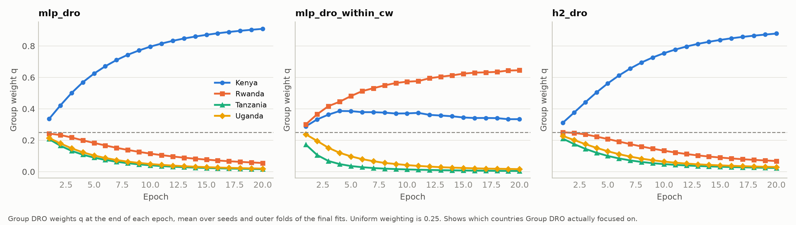
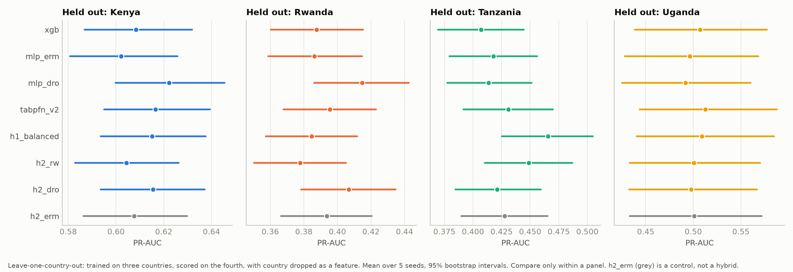

# Do tabular foundation models help the worst-off group? TabPFN, Group DRO and their combination for predicting bank account ownership in Kenya, Rwanda, Tanzania and Uganda

*Draft, 2026-11-03. Every number traces to a file in `week4/results/`; the source of each table is given beneath it. Hypotheses and falsification rules were committed before any experiment ran (`week4/HYPOTHESES.md`, commit `4929a9b`).*

## Abstract

Pooled accuracy can hide which group a model fails. We ask whether two routes to a fairer classifier improve performance for the worst-off country when predicting bank account ownership from household survey data in Kenya, Rwanda, Tanzania and Uganda (23,524 labelled rows). The model-side route is TabPFN v2, a pretrained tabular foundation model used without tuning. The training-side route is Group DRO with country as the group. We also test two hybrids that combine them, and check every method under leave-one-country-out evaluation. Six hypotheses and their falsification rules were pre-registered. Evaluation uses nested cross-validation over five seeds, out-of-fold PR-AUC, and paired stratified bootstrap intervals.

TabPFN matches tuned XGBoost on pooled PR-AUC (0.590 against 0.588, paired difference +0.003 [−0.000, +0.006]) at no tuning cost, but leaves the gap between pooled and worst-country PR-AUC unchanged. Group DRO lowers worst-country PR-AUC by 0.017 [0.011, 0.036] and pooled PR-AUC by 0.040. Its logged group weights show why: it concentrates on the country with the highest training loss (Kenya, 25% prevalence), not the country with the lowest PR-AUC (Rwanda). When class weights are balanced within each country, it does focus on Rwanda, and Rwanda's PR-AUC still does not move. No hybrid beats the better of its parents, and no method is consistently best when a country is held out. The worst-off country is Rwanda, not Uganda as the study framework expected. Worst-country PR-AUC stays between 0.44 and 0.47 for every model and objective outside the extreme step-size ablations, and the pooled-to-worst gap is about 0.12 for every model trained with pooled class weights and without Group DRO. We read this as a limit set by the data rather than by the model or the training objective.

## 1. Introduction

Account ownership is "the fundamental measure of financial inclusion" (Demirgüç-Kunt et al., 2022, p.27). Machine learning has been used to predict it from household survey features, including on the dataset studied here (Ismail et al., 2021; Balde et al., 2022). Those studies report pooled accuracy or F1. A pooled score says little about the group for which a poor model does the most harm: the group least likely to be correctly identified, and so least likely to be reached by outreach. This is a mini-max, or Rawlsian, view of fairness: judge a model by the error of its worst group (Barrainkua et al., 2025, p.4-5).

There are two plausible routes to a model that serves the worst-off group better.

- **Model side.** TabPFN v2 is a transformer pretrained on synthetic datasets that predicts by in-context learning, and is reported to beat tuned gradient-boosted trees on small tabular datasets (Hollmann et al., 2025). If it generalises better from few examples, it might help a small, low-prevalence country most.
- **Training side.** Group DRO minimises the loss of the worst group directly, instead of the average loss (Ghosal and Li, 2023, p.2-3; Stahlschmidt et al., 2024, p.5).

The evidence for each is mixed. Independent benchmarks find tabular foundation models roughly matching established methods (Shaktah et al., 2026), and a recent review concludes that fairness needs an explicit intervention beyond pretraining (Kurashkin et al., 2026, p.22-23). On the WILDS benchmark Group DRO generally does not beat ERM, and where it wins it matches simple reweighting (Koh et al., 2021, p.20-22, p.92). We found no study in our literature that combines a tabular foundation model with group-robust training, none that evaluates worst-group PR-AUC, and none that analyses these four countries per country or under leave-one-country-out shift (`week4/paper/LITERATURE_GAPS.md`).

**Research questions.**

- **RQ1.** Does TabPFN v2 out of the box match or beat tuned XGBoost and an MLP on pooled PR-AUC?
- **RQ2.** How large is the gap between pooled and worst-country PR-AUC, and does TabPFN narrow it relative to XGBoost?
- **RQ3.** Does Group DRO improve worst-country PR-AUC over ERM, at what pooled cost, and does it beat inverse-frequency reweighting?
- **RQ4.** Does any combination of TabPFN with group-robust training beat both parents on worst-country PR-AUC?
- **RQ5.** Under leave-one-country-out evaluation, is any method consistently best?
- **RQ6.** Do SHAP-measured drivers differ by country beyond resampling noise, and does Group DRO change them for the worst-off country?

**Contributions.**

1. A pre-registered, leakage-checked benchmark of TabPFN v2, XGBoost, MLPs, Group DRO and two TabPFN hybrids on worst-country PR-AUC, with an exact reproduction of the earlier baseline.
2. Evidence, from logged group weights, of why Group DRO fails here: the worst group by training loss differs from the worst group by PR-AUC, and correcting the target does not help.
3. Evidence that worst-country PR-AUC barely moves across all model families and objectives tested.
4. A resampling-noise baseline for comparing SHAP feature rankings between countries.

## 2. Related work

**Tabular foundation models.** TabPFN v2 approximates the posterior predictive distribution through in-context learning over a labelled context, and its authors caution that its results are not evidence of scaling beyond 10,000 samples and 500 features (Hollmann et al., 2025, p.2, p.6). Independent evidence is more mixed. Shaktah et al. (2026) find TabPFN beats the best established model in only 2 of 12 clinical tasks, mostly within ±0.02 AUROC. Costa et al. (2026) report the highest AUC but weaker conditional coverage than gradient-boosted trees. Kurashkin et al. (2026, p.19) argue that the composition of the context now carries the weight hyperparameters once carried, which motivates our context-based hybrid. On group shift, Harijeyan (2025) reports TabPFN with the best or near-best out-of-distribution accuracy on demographic hold-outs of Adult. Das and Cui (2026) find TabPFN degrades less than elastic net and random forest for under-sampled ancestry groups, but fails when effects vary across groups. Liu et al. (2026) find causal pretraining "helpful but insufficient" for fairness.

**Trees and deep models.** Gradient-boosted trees remain strong on small and medium tabular data (Shwartz-Ziv and Armon, 2021; Borisov et al., 2024, p.15). We use XGBoost (Chen and Guestrin, 2016) as the reference model.

**Group robustness.** Group DRO minimises the maximum expected loss over groups, optionally with a C/√n_g adjustment for small groups (Ghosal and Li, 2023, p.2-3; Stahlschmidt et al., 2024, Eq. 3-4). Its empirical record is modest. On WILDS it rarely beats ERM out of distribution and matches label reweighting on CivilComments (Koh et al., 2021, p.22, p.92). On gene-expression data, its worst-group gains are small and within large standard deviations (Stahlschmidt et al., 2024, p.5). Koh et al. (2021, p.113-115) also show that a worst-group gap can come from intrinsic noise rather than scarcity. Training more on that group does not help. Their PovertyMap task, which predicts asset wealth across unseen African countries, is the nearest analogue to our leave-one-country-out setting (p.102-105).

**Financial inclusion.** Previous work on this dataset reports pooled accuracy and F1 from single holdout splits (Ismail et al., 2021; Balde et al., 2022), with no per-country results. Chen (2026) reports region-specific SHAP signs for digital literacy using Findex data. Coston et al. (2019) study fair transfer of mobile-money credit models between East African countries.

## 3. Data

The data are the labelled rows of the Zindi "Financial Inclusion in Africa" training file: 23,524 respondents, with the binary target `bank_account`. The unlabelled test file has no labels and is not used.

| Country | Survey year | Rows | Positives | Prevalence |
|---|---|---|---|---|
| Kenya | 2018 | 6,068 | 1,521 | 25.1% |
| Rwanda | 2016 | 8,735 | 1,003 | 11.5% |
| Tanzania | 2017 | 6,620 | 607 | 9.2% |
| Uganda | 2018 | 2,101 | 181 | 8.6% |
| All | | 23,524 | 3,312 | 14.1% |

*Table 1. Source: `results/per_country_counts.csv`.*

There are ten features: `country`, `location_type`, `cellphone_access`, `household_size`, `age_of_respondent`, `gender_of_respondent`, `relationship_with_head`, `marital_status`, `education_level` and `job_type`. The data audit (`results/data_audit.md`) found four properties that shape interpretation:

1. **Country and survey year are fully confounded.** One survey year per country, so a country effect cannot be separated from a survey-round effect.
2. **Tanzania's `location_type` runs the other way.** Its positive rate is 20.7% in rural areas and 4.8% in urban ones, while the other three countries have higher rates in urban areas. Findex reports Tanzania's urban adults as more likely to have an account (Demirgüç-Kunt et al., 2022, p.47), though with a different definition and year. A swapped coding is possible but cannot be proven from the data, so the values were left unchanged.
3. **`job_type` is coded very differently by country.** Total variation distance reaches 0.866 between Rwanda and Uganda. Models can therefore partly infer country even when `country` is dropped.
4. **`bank_account` is not Findex's "account".** Findex counts mobile money (Demirgüç-Kunt et al., 2022, p.33), so the two ownership rates cannot be compared. Sources in our literature also disagree about the data's provenance (Ismail et al., 2021, p.2; Balde et al., 2022, p.2).

## 4. Methods

### 4.1 Evaluation design

- **Nested cross-validation.** 5 outer and 3 inner folds, stratified by country and label. Every preprocessing step is fitted inside each training fold, and all tuning happens in the inner loop.
- **Seeds.** Seeds 0 to 4 control the outer split, the inner splits and model initialisation. Every model sees the same splits for a given seed, so all comparisons are paired.
- **Primary metric.** PR-AUC (average precision), computed on each seed's out-of-fold predictions concatenated across outer folds, then averaged over seeds. Fold-mean PR-AUC is reported for comparison with the earlier baseline.

We define:

| Quantity | Definition |
|---|---|
| P(m) | Pooled PR-AUC of model m |
| P_c(m) | PR-AUC of model m on the rows of country c |
| W(m) | Worst-country PR-AUC: min over c of P_c(m), with the country chosen separately for each model and bootstrap replicate |
| G(m) | Gap, P(m) − W(m) |

- **Why the worst country floats.** Earlier reports showed Rwanda, not Uganda, with the lowest PR-AUC. Fixing the country in advance could have measured the wrong group. Choosing it after seeing results would have been selection.
- **Prevalence.** Raw PR-AUC depends on prevalence, so W is also reported on two other scales: excess over prevalence and lift over prevalence.
- **A known bias.** The minimum of noisy estimates is biased downward, more so for small groups.

### 4.2 Models

| Arm | Description |
|---|---|
| `xgb` | XGBoost with balanced class weights, the same imbalance handling as the MLPs. 15 TPE trials over the baseline search space. |
| `xgb_spw` | XGBoost tuning `scale_pos_weight` instead, as the earlier baseline did. A sensitivity arm. |
| `mlp_erm` | The baseline two-layer MLP with categorical embeddings, balanced class weights, 8 trials, 20 epochs. Selected on pooled inner PR-AUC. |
| `tabpfn_v2` | TabPFN v2 weights, requested explicitly because the installed package (`tabpfn` 9.2.0) defaults to v3.5. Default settings: 8 estimators, no tuning. |

The only departure from TabPFN's defaults concerns context size. Training folds hold about 18,800 rows, above v2's supported 10,000. So each of the 8 estimators reads its own context of about 10,000 rows, stratified by country and label, and dealt so that every training row appears in at least one context. TabPFN ran on an RTX 4080 SUPER with its default fp16 autocast. On synthetic labels, GPU scores differed from float32 CPU scores by at most 0.0038, with AUC 0.91525 against 0.91526 (`results/logs/20261103_130647/preflight.log`).

### 4.3 Group DRO and comparators (E3)

All E3 MLP arms use the same network and are selected on worst-country inner PR-AUC. This ensures the selection rule cannot favour Group DRO. The training objective is

  minimise over θ:  max over g of  [ L_g(θ) + C/√n_g ],

where L_g is the mean class-weighted loss of country g (Ghosal and Li, 2023, p.2-3; Stahlschmidt et al., 2024, Eq. 4).

**Our implementation.** The paper usually cited for the online update, Sagawa et al. (2020), is not in our literature, so the following is our own implementation statement:

- A weight q_g is kept for each group. Each step multiplies it by exp(η·(L_g + C/√n_g)) and renormalises, computed in log space for stability. The model then takes a gradient step on Σ_g q_g (L_g + C/√n_g).
- Every batch of 256 rows holds 64 rows from each country, following the uniform per-domain sampling described by Koh et al. (2021, p.66).
- Step size η is searched on a log scale over [0.001, 1], which includes the 0.01 default of Koh et al. (2021, p.66). C is searched over {0, 1, 2, 4}.

| Arm | Description |
|---|---|
| `mlp_erm_wc` | ERM, the primary RQ3 comparator |
| `mlp_rw` | Inverse-frequency reweighting: each row weighted N / (K·n_country), times its class weight |
| `mlp_dro` | Group DRO, the primary RQ3 arm |
| `mlp_erm_within_cw`, `mlp_dro_within_cw` | A pair with class weights balanced inside each country. Added before any result, because pooled class weights could make Group DRO target the highest-prevalence country (`DECISIONS.md` D3.3). |
| `xgb_rw` | Reweighted XGBoost, a comparator |
| Ablations | Step size η ∈ {0, 0.001, 0.01, 0.1, 1} and C ∈ {0, 1, 2, 4}, each reusing `mlp_dro`'s tuned parameters with one setting changed |
| E7 | Group DRO with eight country-by-label groups (`mlp_dro_country_label`) |

### 4.4 Hybrids (E5)

- **H1, group-balanced context (`h1_balanced`).** Every country contributes the same number of rows to each TabPFN context. The number is set by the smallest country, about 1,680 rows per country per outer fold. Within each country its own class ratio is kept. Nothing is trained: only the mix of countries in the prompt changes.
- **H2, embeddings plus a head (`h2_erm`, `h2_rw`, `h2_dro`).** A one-hidden-layer head is trained on TabPFN's 192-dimensional embeddings, using 8 estimators. A naive embedding call leaks labels: on pure-noise labels a head scored AUC 0.955 when a row sat in its own context. So training rows are embedded out of fold, using five internal folds, which brought the noise AUC down to 0.520 (`results/feasibility.md`). The head is trained with ERM, country reweighting or Group DRO. `h2_erm` is a control for the representation alone, not a hybrid.
- **H3, fine-tuning TabPFN with a Group DRO loss.** Not run. The installed package exposes a custom loss only through a private method, and its batches carry no group labels (`DECISIONS.md` D1.8).

### 4.5 Leave-one-country-out (E4)

- **Design.** Train on three countries, test on the fourth, for each of the four countries and five seeds. The `country` feature is dropped for every model. Preprocessing is fitted on the three training countries, Group DRO uses them as its groups, and tuning uses inner folds within them.
- **Comparisons.** PR-AUC is compared only within a held-out country, because prevalence differs between countries.
- **Hybrids.** All four hybrid arms were run under this design before any result was seen, so none was picked after the fact.

### 4.6 Explanations (E6)

For seed 0, every row is explained by the model of its own outer fold.

- **XGBoost** uses interventional TreeSHAP.
- **The ERM and Group DRO MLPs** use exact interventional Shapley values over the raw features. These are the values KernelSHAP approximates.
- **Background.** 200 training rows per fold, stratified by country and label.
- **TabPFN** is excluded: exact values would need about 200,000 TabPFN predictions per row.

**Rankings and test.** Features are ranked by mean absolute attribution over 9 features, excluding `country`. Every ranking uses 1,050 rows, half of Uganda's sample, so that country comparisons and noise comparisons use the same sample size. In each of 200 repeats:

- the cross-country difference is the mean over the 6 country pairs of 1 − Spearman ρ between one subsample per country;
- the noise baseline is the mean over countries of the same quantity between two disjoint subsamples of one country.

The statistic is their difference. Kendall τ and top-3 overlap are also reported.

**Group DRO part.** In the ERM MLP's worst country, DRO and ERM rankings on the same rows are compared against each model's own resampling noise.

### 4.7 Statistics

- **Bootstrap.** 2,000 replicates, resampling rows within country-by-label strata. Every model and seed uses the same resampled rows, so every difference is paired.
- **Intervals.** 95% percentile intervals. A replicate's value is the mean over seeds.
- **Seed noise.** The SD over seeds of the per-seed paired difference.
- **Smallest effect of interest.** δ = 0.01 PR-AUC. This is our own judgement; no paper in our literature supplies one.
- **Multiple comparisons.** Holm correction across hybrids (RQ4), and across method pairs within each held-out country (RQ5).
- **Pre-registered falsification rules:**

| RQ | Falsified if |
|---|---|
| RQ1 | XGBoost's marginal interval for P lies entirely above TabPFN's |
| RQ2 | The paired interval of G(TabPFN) − G(XGBoost) includes 0 |
| RQ3 | Any one of: (1) the gain W(DRO) − W(ERM) is within noise (interval includes 0, or \|gain\| ≤ seed SD); (2) gain − max(cost, 0) < δ, where cost = P(ERM) − P(DRO); (3) the paired interval of W(DRO) − W(reweighted) includes or lies below 0 |
| RQ4 | No hybrid's Holm-corrected lower bound of W(H) − max(W(TabPFN), W(DRO)) is above 0, with the max taken within each replicate |
| RQ5 | No method is best in at least 3 of 4 held-out countries with clear Holm-corrected wins over every other method, while never being clearly beaten |
| RQ6 | The interval of cross-country minus noise disagreement includes or lies below 0 |

### 4.8 Baseline reproduction (E1)

The earlier tuned XGBoost and MLP were rerun through the baseline's own code. Every fold PR-AUC and decision threshold matched the original run to full precision (`results/baseline_reproduction_summary.md`).

The baseline fitted its preprocessing before cross-validation. Refitting it inside each fold changed nothing for XGBoost and moved MLP fold-mean PR-AUC by −0.0009. That is negligible next to δ.

## 5. Results

The 32 arms ran to completion: 760 of 760 folds (`results/phase4_completion.md`).

### 5.1 RQ1 and RQ2: TabPFN against XGBoost and the MLP

| Arm | P | W (Rwanda) | G | Uganda | Kenya | Tanzania |
|---|---|---|---|---|---|---|
| `tabpfn_v2` | **0.590** [0.575, 0.606] | **0.468** [0.437, 0.495] | 0.122 | 0.533 | 0.650 | 0.623 |
| `xgb` | 0.588 [0.572, 0.603] | 0.467 [0.438, 0.495] | 0.120 | 0.534 | 0.646 | 0.621 |
| `mlp_erm` | 0.582 [0.567, 0.597] | 0.460 [0.429, 0.486] | 0.122 | 0.516 | 0.642 | 0.617 |
| `xgb_spw` | 0.565 | 0.444 | 0.120 | 0.509 | | |

*Table 2. Five-seed means with 95% bootstrap intervals. Rwanda is the worst country for all four arms in every seed. Sources: `results/metrics/summary.md`, `nested_marginal.csv`, `worst_country.csv`.*

- **RQ1: matches, not falsified.** The marginal intervals of TabPFN and XGBoost overlap. The paired difference in P is +0.003 [−0.000, +0.006], below δ.
- **TabPFN against the MLP.** Ahead by +0.009 [0.005, 0.012] on P and +0.008 [0.002, 0.016] on W. Both paired intervals exclude 0, but both differences are below δ and the marginal intervals overlap.
- **RQ2: falsified.** G(TabPFN) − G(XGBoost) = +0.002 [−0.002, +0.008], so TabPFN neither narrows nor widens the gap. W differs by +0.001 [−0.006, +0.006]. Measuring W on excess or lift gives the same ordering.

**A scoring artefact in `xgb_spw`.** It scores 0.565 on pooled out-of-fold PR-AUC but 0.589 on fold-mean PR-AUC. Tuning `scale_pos_weight` separately in each fold shifts the score scale from fold to fold. That hurts a ranking metric computed over concatenated folds but not one computed within folds. The earlier baseline reported fold-means, so its XGBoost was not weaker than ours. Its scores are simply less comparable across folds.

Runtime: one TabPFN fit and prediction took about 3 s per outer fold on the GPU, against 786 s for a comparable fit on a laptop CPU in Phase 1 (`results/feasibility.md`).

### 5.2 RQ3: Group DRO

| Arm | P | W | Rwanda | Tanzania | Uganda |
|---|---|---|---|---|---|
| `mlp_erm_wc` (ERM) | 0.583 | 0.461 | 0.461 | 0.616 | 0.517 |
| `mlp_rw` (reweighted) | 0.580 | 0.460 | 0.460 | 0.612 | 0.513 |
| `mlp_dro` (Group DRO) | 0.543 | 0.444 | 0.444 | **0.486** | 0.482 |
| `mlp_erm_within_cw` | 0.553 | 0.462 | 0.462 | 0.616 | 0.520 |
| `mlp_dro_within_cw` | 0.502 | 0.460 | 0.460 | **0.463** | 0.495 |
| `mlp_dro_country_label` (E7) | 0.516 | 0.458 | 0.458 | 0.487 | 0.504 |

*Table 3. Sources: `results/metrics/summary.md`, `nested_marginal.csv`.*

| Comparison | ΔW [95% CI] | ΔP [95% CI] |
|---|---|---|
| DRO − ERM | −0.017 [−0.036, −0.011] | −0.040 [−0.045, −0.034] |
| DRO − reweighted | −0.016 [−0.033, −0.010] | −0.037 [−0.043, −0.032] |
| DRO − ERM selected on pooled (sensitivity) | −0.016 [−0.034, −0.010] | −0.039 [−0.044, −0.033] |
| DRO − ERM, within-country class weights | −0.001 [−0.041, +0.003] | −0.051 [−0.058, −0.044] |
| E7 country-by-label DRO − country DRO | +0.015 [+0.003, +0.027] | −0.027 [−0.033, −0.023] |
| Reweighted − ERM XGBoost | −0.004 [−0.009, −0.001] | −0.002 [−0.004, −0.000] |

*Table 4. Paired differences. Source: `results/metrics/nested_paired.csv`. The intervals for W are asymmetric because the worst country can change between replicates.*

**RQ3 is falsified.** The three criteria:

1. **Within noise:** not met. The gain's interval excludes 0, and |gain| = 0.017 exceeds its seed SD of 0.013. But the gain is negative: Group DRO lowers worst-country PR-AUC.
2. **Trivial against cost:** met. gain − cost = −0.057, below δ.
3. **Matched by reweighting:** met. Group DRO lies entirely below reweighting.

Reweighting itself changes nothing for the MLP and slightly lowers W for XGBoost.

**Ablations** (`fig_rq3_sweeps.png`):

- **Step size.** Worst-country PR-AUC falls monotonically as η grows: 0.454 at η = 0, 0.455 at 0.001, 0.451 at 0.01, 0.417 at 0.1 and 0.401 at 1.0. At η ≥ 0.1 the worst country becomes Tanzania.
- **Adjustment C.** No effect: W lies between 0.442 and 0.446 for every C.
- **E7.** Country-by-label groups improve on country groups, but stay below ERM (0.458 against 0.461) at a pooled cost of 0.067.

*Figure 1. Group DRO weights q by epoch, mean over seeds and folds. Source: `results/metrics/q_history_*.csv`.*

**Mechanism.** The logged weights show which countries Group DRO actually focused on (Figure 1).

- **With pooled class weights,** q moves steadily towards Kenya and ends at 0.91, against 0.06 for Rwanda and 0.02 each for Tanzania and Uganda. Kenya has the highest training loss throughout (final group loss 0.60, against 0.39 to 0.49 for the others) because it has the highest prevalence. The worst country by PR-AUC is Rwanda. Group DRO maximises the worst group's *loss*, and here that is not the worst group's *ranking quality*.
- **With within-country class weights,** q does move to Rwanda (0.65). Rwanda's PR-AUC is unchanged (0.460 against 0.462).
- **Both DRO arms push Tanzania's weight to near zero.** Tanzania's PR-AUC collapses, from 0.616 to 0.486 and 0.463. Most of Group DRO's pooled cost is this collapse.

That Tanzania collapses when the model attends mostly to other countries fits the reversed `location_type` relationship described in Section 3, but we have not tested it.

### 5.3 RQ4: hybrids

| Hybrid | W | W − max(W(TabPFN), W(DRO)) [95% CI] | Holm p |
|---|---|---|---|
| H1 `h1_balanced` | 0.465 | −0.003 [−0.008, −0.001] | 1.0 |
| H2 `h2_rw` | 0.459 | −0.009 [−0.014, −0.004] | 1.0 |
| H2 `h2_dro` | 0.455 | −0.013 [−0.029, −0.008] | 1.0 |
| Control `h2_erm` | 0.459 | −0.009 [−0.013, −0.003] | — |

*Table 5. Source: `results/metrics/nested_paired.csv`.*

**RQ4 is falsified.** Every hybrid falls below the better of its parents. In the point estimates that parent is TabPFN (W 0.468, against 0.444 for the Group DRO MLP).

- **H1** comes closest, with a loss inside δ, and keeps TabPFN's pooled PR-AUC (0.588).
- **The H2 heads** do no better than the ERM-head control.
- **The DRO head** inherits Group DRO's drift towards Kenya (final q 0.88, Figure 1).

### 5.4 RQ5: leave-one-country-out

| Held out | XGB | MLP | DRO MLP | TabPFN | H1 | H2-rw | H2-DRO |
|---|---|---|---|---|---|---|---|
| Kenya | 0.608 | 0.602 | **0.622** | 0.617 | 0.615 | 0.604 | 0.615 |
| Rwanda | 0.388 | 0.386 | **0.415** | 0.396 | 0.385 | 0.378 | 0.407 |
| Tanzania | 0.407 | 0.418 | 0.414 | 0.431 | **0.466** | 0.449 | 0.421 |
| Uganda | 0.507 | 0.497 | 0.492 | **0.513** | 0.509 | 0.501 | 0.498 |

*Table 6. PR-AUC on the held-out country, five-seed means. Sources: `results/metrics/loco_marginal.csv`, `loco_paired.csv`, `loco_consistency.csv`.*

**RQ5 is falsified.** No method is consistently better, and every method is clearly beaten, after Holm correction, in at least one held-out country.

- **Tanzania:** H1 has the only clear win over all six other methods.
- **Rwanda:** the Group DRO MLP beats five of six methods clearly, but is not separated from H2-DRO (Holm p = 0.14).
- **Kenya and Uganda:** no clear winner. Uganda's intervals are about ±0.07 wide.

*Figure 2. Leave-one-country-out PR-AUC with 95% intervals. Compare within a panel only.*

**Drop from within-country cross-validation** (`results/metrics/e2_to_e4_drop.csv`):

| Country | Drop | Note |
|---|---|---|
| Kenya | 0.03 to 0.04 | |
| Rwanda | 0.07 to 0.08 | |
| Tanzania | 0.15 to 0.21 | |
| Uganda | 0.00 to 0.03 | Every interval includes 0 |

Group DRO has the smallest drop in every country: 0.018, 0.029, 0.072 and −0.010. Its within-country scores are lower to begin with, notably in Tanzania, so part of this is mechanical. Following Koh et al. (2021, p.17), we do not read these drops as pure shift, because training size also differs and a country may be intrinsically harder.

### 5.5 RQ6: explanations

| Model | Cross-country minus noise, 1 − Spearman ρ [95% interval] |
|---|---|
| XGBoost (primary) | 0.038 [0.033, 0.042] |
| ERM MLP | 0.034 [0.028, 0.040] |
| Group DRO MLP | 0.009 [0.000, 0.021] |
| Group DRO − ERM in Rwanda | 0.007 [−0.017, +0.025] |

*Table 7. Source: `results/e6/rq6_tests.csv`. Kendall τ gives the same reading.*

**RQ6 is not falsified for the primary model.** For XGBoost and the ERM MLP, feature rankings differ between countries by more than two random halves of one country do. The excess is small, though:

- `cellphone_access` and `education_level` are the two most-relied-on features in every country, for every model (`results/e6/mean_abs_shap_by_country.csv`, `fig_e6_rankings.png`).
- The variation is mainly further down the ranking. For example, XGBoost relies on `location_type` less in Tanzania than in the other three countries.

**The Group DRO parts.** For the Group DRO MLP, the interval's lower bound is 0, which counts as including 0. In Rwanda, Group DRO does not change which features matter beyond noise.

**A caveat on the MLP rows of Table 7.** The MLPs were refitted for E6 with 32 CPU threads, while their training runs used 5. MLP training is deterministic only at a fixed thread count. On this hardware, changing it moved scores by up to 0.049, mean 0.009. So the MLP attributions explain models with the same data, hyperparameters and seed as the evaluated ones, but a different floating-point path. The largest per-fold score difference from the saved predictions was 0.02 to 0.17. XGBoost refits matched to 3 × 10⁻⁸ (`results/e6/refit_check_*.json`). The code now refits at each fold's recorded thread count, but E6 was not rerun.

SHAP describes what a model relies on. It does not establish why people have bank accounts.

## 6. Discussion

**The gap comes from the data, not the model.** Across 24 within-country model variants, worst-country PR-AUC sits between 0.40 and 0.47. Excluding the deliberately extreme step-size ablations, it sits between 0.44 and 0.47. The gap between pooled and worst-country PR-AUC is 0.12 for every model trained with pooled class weights and without Group DRO. Where the gap is smaller, it is because pooled PR-AUC fell, not because the worst country improved. Rwanda stays the worst country throughout:

- a foundation model pretrained on millions of synthetic tasks;
- a tuned tree ensemble;
- reweighting;
- a training objective that targets Rwanda directly;
- a TabPFN context with equal country shares.

This matches the WILDS observation that a worst-group gap can reflect intrinsic difficulty, which more attention to the group does not fix (Koh et al., 2021, p.113-115).

Rwanda is not a small group. It has the most rows (8,735) and the second-highest prevalence, so its low PR-AUC is not a sample-size problem. Our reading is that these ten survey features separate account holders from non-holders less well in Rwanda than elsewhere. We did not test why.

**Group DRO's failure has two parts:**

1. **It targets the wrong country.** It weights groups by training loss, and a log-loss is highest in the highest-prevalence group. A mini-max objective on loss is therefore not a mini-max objective on a ranking metric when prevalence differs between groups. We found no discussion of this in our literature.
2. **Pointing it at the right country doesn't help.** Correcting the target with within-country class weights moved the weight to Rwanda and did not move Rwanda's PR-AUC. The cost fell on Tanzania, which the objective then ignored.

This mirrors Koh et al. (2021) and Stahlschmidt et al. (2024), and the pre-registration said in advance that it was a plausible outcome.

**TabPFN is a practical result.** Untuned TabPFN v2 matched tuned XGBoost within 0.003 pooled PR-AUC in about 3 s per fold on a GPU. This agrees with independent clinical benchmarks that find TabPFN roughly level with established methods (Shaktah et al., 2026). It neither helped nor harmed the worst-off country. Pretraining alone did not supply fairness here, consistent with Liu et al. (2026) and Kurashkin et al. (2026, p.22-23).

**Two exploratory observations, not pre-registered claims:**

- **H1's clear win when Tanzania is held out.** Equal country shares in the context gave 0.466 against 0.431 for TabPFN's default context. Context composition matters most when the target country's feature relationships differ from the training countries'. That fits the view that context is now a design lever (Kurashkin et al., 2026, p.19).
- **Group DRO's strength under shift in Kenya and Rwanda,** despite being the weakest model within countries. This is a pattern seen after the fact, partly mechanical, and needs a pre-registered test.

**Uganda is not the worst-off country.** The study framework expected Uganda, which has the smallest sample and lowest prevalence. Uganda is the worst country in only one seed of one ablation. Its per-country intervals are also wide (about ±0.07 under leave-one-country-out), so this study can say little about Uganda specifically. Fixing the analysis on Uganda in advance would have measured the wrong group.

**For practice.** If the goal is to reach the unbanked in the worst-served country, our results point to better information for that country rather than a different model or objective. That could mean features that capture mobile money, documentation barriers or distance, which Findex reports as barriers (Demirgüç-Kunt et al., 2022, p.53-54). This is our inference and was not tested. A better classifier also does not by itself produce inclusion: free accounts alone had no measurable welfare effect in Uganda (Demirgüç-Kunt et al., 2022, p.28).

## 7. Limitations and ethics

- **Confounding.** Country is fully confounded with survey year, so "country" effects may be survey-round effects.
- **Label meaning.** `bank_account` excludes mobile money, the main route to account ownership in East Africa (Demirgüç-Kunt et al., 2022, p.20; Engelmann et al., 2018). The data's provenance is disputed in our sources.
- **Data anomalies left uncorrected.** Tanzania's `location_type` coding and the country-specific `job_type` coding. Both may affect leave-one-country-out results, and the second lets models infer country after `country` is dropped.
- **Context.** TabPFN v2 read stratified contexts of about 10,000 rows rather than the whole training fold, because of its supported size. It ran in fp16, whose measured effect on scores was at most 0.004.
- **Tuning budgets** follow the earlier baseline: 15 trials for XGBoost and 8 for the MLPs, with Group DRO searching two more hyperparameters in the same 8 trials. Twenty epochs without early stopping were used throughout, although Koh et al. (2021, p.67) note that Group DRO works best while training loss has not vanished. The step-size sweep partly addresses this.
- **Leave-one-country-out tuning** used inner folds within the training countries, so model selection was not itself shift-aware.
- **H2 tuning.** Inner-loop embeddings may carry inner-validation labels through the context. Outer test rows are not affected.
- **The floating worst-country minimum** is biased downward for small groups.
- **E6** uses one seed, and its MLP attributions explain refitted siblings of the evaluated models (Section 5.5).
- **Group DRO's update rule** is given as our own statement, because its usual source is not in our literature.
- **Ethics.** The data are survey responses about individuals. A model that ranks people by their probability of having a bank account could support outreach, but it could also support exclusion or targeted marketing. The consumer risks Findex reports in Uganda and Kenya (Demirgüç-Kunt et al., 2022, p.150, p.172) apply to whatever follows outreach. No model here is fit for deployment decisions about individuals.

## 8. Conclusion

Neither route improved prediction for the worst-off country.

- **TabPFN v2** matched tuned XGBoost without tuning but left the gap unchanged.
- **Group DRO** made the worst country worse. With pooled class weights it optimised for the highest-loss country, Kenya, instead of the lowest-PR-AUC country, Rwanda. When redirected to Rwanda it still did not help.
- **The hybrids** did not beat their parents.
- **Under leave-one-country-out evaluation,** no method was consistently best.

Worst-country PR-AUC stayed between 0.44 and 0.47 across every model family and objective, outside the extreme step-size ablations. For this task, the limit on serving the worst-off country appears to lie in the data rather than in the choice of model or objective.

## Completed and not completed

| Experiment | Status |
|---|---|
| E1 baseline reproduction | Completed: exact reproduction |
| E2 main benchmark | Completed: 5 seeds × 5 folds |
| E3 Group DRO, reweighting, ablations, within-country pair | Completed |
| E4 leave-one-country-out, including all hybrids | Completed |
| E5a H1, E5b H2 (three heads) | Completed |
| E5c H3, fine-tuning TabPFN with Group DRO | **Not completed.** Infeasible with the installed package (D1.8) |
| E6 SHAP | Completed for seed 0. MLP attributions carry the refit caveat. TabPFN not explained. |
| E7 country-by-label groups | Completed |

**Changes after results were seen.** None to hypotheses, rules, arms or settings. The within-country class-weight pair (D3.3) was added before any result existed. The E6 refit fix (D4.2) changes code only; E6 was not rerun.

## Reproducibility

- **Code:** `week4/src/`; run guide `week4/GPU_RUN.md`.
- **Results commit:** `1e5f1d3`, run from `ddc0584`.
- **Environment:** Python 3.13.18, torch 2.12.1+cu130, `tabpfn` 9.2.0 with v2 weights, on an NVIDIA RTX 4080 SUPER and 24 CPU threads. Total wall time was 3 h 48 min.
- **Per-fold records.** Every fold's out-of-fold scores, parameters, thread count and host are in `week4/results/oof/`. Every metric in this paper is recomputed from those files by `week4/src/analysis.py`.

## Acknowledgement

TabPFN v2 weights are used under the Prior Labs License 1.1.

## References

Only papers in `applied_research/literature/` are cited. PDF page numbers are used.

- Balde, A., Adhikari, S., Singh, A., Mabuela, N. P., Choudhary, A. (2022). An efficient approach for predicting the state of financial inclusion by addressing class imbalance using the oversampling technique. *ICCSEA 2022*.
- Barrainkua, A., Gordaliza, P., Lozano, J. A., Quadrianto, N. (2025). Preserving the fairness guarantees of classifiers in changing environments: a survey. *ACM Computing Surveys* 57(6).
- Borisov, V., Leemann, T., Seßler, K., Haug, J., Pawelczyk, M., Kasneci, G. (2024). Deep neural networks and tabular data: a survey. *IEEE TNNLS* 35(6).
- Chen, S. (2026). Evaluating the non-linear impact of digital literacy on financial inclusion: evidence from emerging economies via explainable deep learning. *Int. J. Comput. Intell. Syst.* 19:296.
- Chen, T., Guestrin, C. (2016). XGBoost: a scalable tree boosting system. *KDD '16*.
- Costa, J. L. De Melo, Popineau, F., Rimmel, A., Doan, B. (2026). High performance, low reliability: uncertainty benchmarking for tabular foundation models. *ESANN 2026*.
- Coston, A., Natesan Ramamurthy, K., Wei, D., Varshney, K. R., Speakman, S., Mustahsan, Z., Chakraborty, S. (2019). Fair transfer learning with missing protected attributes. *AIES '19*.
- Das, A., Cui, Y. (2026). Bridging ancestry gaps in genomic risk prediction with tabular foundation models. *Bioinformatics* 42, btag217.
- Demirgüç-Kunt, A., Klapper, L., Singer, D., Ansar, S. (2022). *The Global Findex Database 2021*. World Bank.
- Engelmann, G., Smith, G., Goulding, J. (2018). The unbanked and poverty: predicting area-level socio-economic vulnerability from M-Money transactions. *IEEE Big Data 2018*.
- Ghosal, S. S., Li, Y. (2023). Distributionally robust optimization with probabilistic group. *AAAI-23*.
- Harijeyan, D. (2025). Evaluating out-of-distribution robustness of TabPFN on tabular data. *ICATC 2025*.
- Hollmann, N., Müller, S., Purucker, L., Krishnakumar, A., Körfer, M., Hoo, S. B., Schirrmeister, R. T., Hutter, F. (2025). Accurate predictions on small data with a tabular foundation model. *Nature* 637, 319-326.
- Ismail, Q. F., Al-Sobh, E. S., Al-Omari, S. S., Bani Yaseen, T. M., Abdullah, M. A. (2021). Using machine learning algorithms to predict the state of financial inclusion in Africa. *ICICS 2021*.
- Koh, P. W., Sagawa, S., Marklund, H., et al. (2021). WILDS: a benchmark of in-the-wild distribution shifts. *ICML 2021*, PMLR 139.
- Kurashkin, S. O., Tynchenko, V. S., Borodulin, A. S., Nelyub, V. A., Kalutsky, N. O., Connie, T. (2026). The current generation of tabular foundation models: a critical review. *Mach. Learn. Knowl. Extr.* 8, 244.
- Liu, Q., Khalil, M., Goel, N. (2026). Causal pre-training under the fairness lens: an empirical study of TabPFN. *WWW '26*.
- Shaktah, L. A., Gustav, M., Lenz, T., Liang, J., Hilgers, L., Carrero, Z. I., Kather, J. N. (2026). Established machine learning matches tabular foundation models in clinical predictions. *BMC Med. Inform. Decis. Mak.* 26:364.
- Shwartz-Ziv, R., Armon, A. (2021). Tabular data: deep learning is not all you need. arXiv:2106.03253v2.
- Stahlschmidt, S. R., Falkman, G., Ulfenborg, B., Synnergren, J. (2024). Domain generalization of deep learning models under subgroup shift in breast cancer prognosis. *IEEE CIBCB 2024*.
